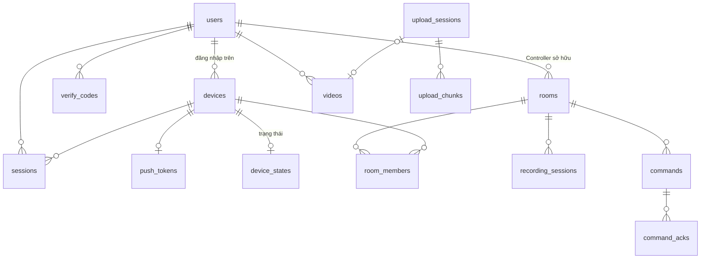

# Cơ sở dữ liệu

SQLite (module `node:sqlite` có sẵn trong Node 24), file `server/data/multicam.db`. Lược đồ đầy đủ: [`server/src/db/schema.sql`](../server/src/db/schema.sql).
Thời gian lưu dạng epoch ms; API trả ISO 8601. ID có tiền tố: `u_` user, `dv_` device, `rm_` room, `mb_` member.

| Bảng | Mục đích | Ràng buộc chính |
|---|---|---|
| `users` | Tài khoản: tên, email, phone, mật khẩu (scrypt), `role`, `active` | email và phone duy nhất; **chỉ một** `role='controller'` (unique index có điều kiện) |
| `devices` | Thiết bị đã đăng nhập (gộp register_device vào login) | `(user_id, client_device_id)` duy nhất |
| `sessions` | Phiên đăng nhập, chỉ lưu hash token | Refresh dùng một lần; `prev_refresh_hash` để phát hiện token bị dùng lại |
| `verify_codes` | Mã 6 số cho signup / forgot_password | Hết hạn 5 phút, tối đa 5 lần thử, gửi lại sau 120 giây |
| `push_tokens` | Token push notification của thiết bị | |
| `rooms` | Phòng điều khiển, mã mời 6 ký tự (hết hạn 10 phút) | Mỗi Controller có tối đa một phòng `open`; mã mời không trùng giữa các phòng đang mở |
| `room_members` | Máy Remote trong phòng, kèm `control_granted` | Một thiết bị chỉ ở **một** phòng tại một thời điểm (`left_at IS NULL`) |
| `device_states` | Pin, dung lượng, camera trước/sau, đang quay | |
| `recording_sessions`, `commands`, `command_acks` | Lệnh Start/Stop/đổi camera; `client_command_id` chống lệnh trùng (1010) | |
| `upload_sessions`, `upload_chunks`, `videos` | Upload theo mảnh có SHA-256; `(local_video_uid, checksum)` chống upload trùng (3005) | |

Xóa tài khoản dùng `ON DELETE CASCADE` để xóa thiết bị, phiên, thành viên phòng và video; file video trên đĩa được xóa riêng.
